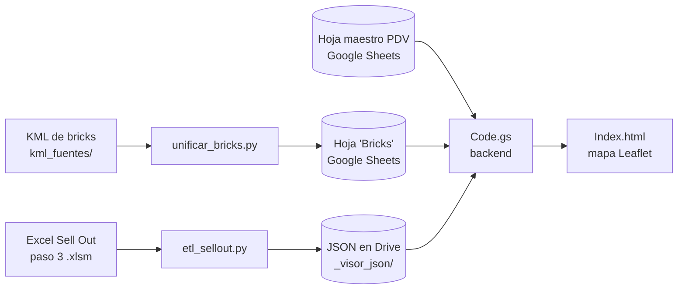

# Mapa de Cobertura Estratégica — ISDIN Colombia

Herramienta de GIS + BI que muestra la cobertura comercial de ISDIN en Colombia (Bogotá, Medellín, Cali y Cartagena). Cruza tres fuentes: **bricks** (zonas geográficas), el **maestro de puntos de venta (PDV)** y los **datos de Sell Out**. Con eso colorea cada zona según su rendimiento (semáforo), analiza la distribución de cada producto y detecta brechas de oportunidad.

El repositorio tiene **tres piezas** que trabajan en cadena:

| Pieza | Tecnología | Qué hace |
| --- | --- | --- |
| **1. Bricks** (`unificar_bricks.py`, `asignar_bricks.py`) | Python + geopandas | Unifica los KML de zonas de 4 ciudades en una sola capa estándar y asigna brick a PDV por coordenadas. |
| **2. ETL de Sell Out** (`etl_sellout.py`) | Python | Lee el Excel consolidado de Sell Out, lo agrega por PDV, BU, SKU y mes, y deja JSON compactos en Google Drive. |
| **3. Visor web** (`Apps Script/`) | Google Apps Script + Leaflet | Mapa interactivo que lee la hoja de Google Sheets (bricks y PDV) y los JSON del ETL. |



---

## Estructura del repositorio

```
Mapa_Colombia/
├── README.md                     # Este archivo
├── CLAUDE.md                     # Guía técnica de la parte de bricks (esquemas de los KML)
├── PLAN_VISOR_PDV.md             # Plan original del visor de PDV
│
├── etl_sellout.py                # 2. ETL de Sell Out (Excel → JSON)
├── config.example.py             #    Plantilla de configuración del ETL (copiar a config.py)
├── requirements.txt              #    Dependencias del ETL (openpyxl, python-calamine)
│
├── unificar_bricks.py            # 1. Unifica los KML → Colombia_Bricks.kml / .xlsx / .geojson
├── asignar_bricks.py             #    Asigna brick a PDV por coordenadas (punto en polígono)
├── brick_ids.csv                 #    Registro permanente de códigos brick_id (no editar a mano)
├── kml_fuentes/                  #    KML originales por ciudad
├── Brick_*.kml                   #    KML originales (Bogotá, Medellín, Cali, Cartagena)
├── Localidad_Bogota.kml          #    Localidades de Bogotá (capa de referencia)
├── Colombia_Bricks.*             #    Capa unificada de 162 bricks (kml, xlsx, geojson)
├── pull.py                       #    Descarga auxiliar de la hoja maestro de PDV
│
├── .clasp.json                   # Configuración de clasp (rootDir = "Apps Script")
└── Apps Script/                  # 3. Visor web (proyecto de Google Apps Script)
    ├── Code.js                   #    Backend — en el editor de Apps Script se ve como "Code.gs"
    ├── Index.html                #    Frontend (Leaflet + KPIs + paneles)
    ├── Menú Principal.js         #    Menú "🛠️ Herramientas Datos" en la hoja
    ├── Módulo Geocodificación.js #    Geocodificación, códigos postales, asignación de bricks
    ├── Módulo Cruce de Datos.js  #    Reconciliación CRM ↔ Sell Out
    ├── Módulo Centros Médicos.js #    Centros médicos cercanos (Places API)
    ├── appsscript.json           #    Manifest del proyecto de Apps Script
    └── CLAUDE.md                 #    Guía técnica del visor y sus módulos
```

> **Nombres `.js` y `.gs`:** clasp descarga los archivos de Apps Script con extensión `.js`. `Apps Script/Code.js` en el repo es el mismo archivo que aparece como `Code.gs` en el editor web.

**No se suben al repositorio** (ver `.gitignore`): `config.py` (rutas locales), los entornos virtuales (`venv/`, `.venv/`), los Excel de datos (`*.xlsx`, `*.xlsm`, salvo `Colombia_Bricks.xlsx`), la salida del ETL (`so_*.json`, `salida/`) y los archivos de credenciales.

---

## 1. Bricks (zonas geográficas)

`unificar_bricks.py` homologa los 4 KML (cada uno con un esquema distinto) a un estándar único: `brick_id`, `nombre`, `zona`, `ciudad`, `departamento`, `nombre_brick`. Genera juntos `Colombia_Bricks.kml`, `.xlsx` y `.geojson` con **162 bricks**.

- **`brick_id`:** código corto y estable de hasta 10 caracteres (`BOG-001`, `MED-001`, `CAL-001`, `CTG-001`), pensado para el campo de brick del CRM. `brick_ids.csv` guarda la memoria de los códigos. Un código asignado nunca cambia ni se reutiliza.
- **Jerarquía:** departamento > ciudad > zona > brick. En Bogotá la zona es la localidad; en el resto de ciudades, zona = ciudad.
- **Formato del Excel:** la hoja *Bricks* incluye centroide, bounding box y geometría GeoJSON, para poder etiquetar PDV desde Apps Script sin archivos externos.

```bash
python unificar_bricks.py                        # regenera Colombia_Bricks.*
python asignar_bricks.py "<xlsx, csv o URL de Google Sheets>"   # asigna brick a PDV
```

Requiere geopandas (ver `CLAUDE.md` para el detalle de cada KML).

---

## 2. ETL de Sell Out (`etl_sellout.py`)

Lee en streaming el Excel consolidado del **paso 3 del Sell Out** (`3. Affiliate_Master so 2026.xlsm`, hoja `Final`), agrega las ventas y escribe en Drive los JSON que consume el visor. Procesa unas 570 mil filas en unos 35 segundos.

### Instalación

```powershell
python -m venv venv
venv\Scripts\python.exe -m pip install -r requirements.txt
copy config.example.py config.py      # y ajustar RUTA_EXCEL y CARPETA_SALIDA
```

Usa **python-calamine** para leer el Excel (rápido). Si no está instalado, cae a **openpyxl** en modo solo lectura.

### Uso

```powershell
venv\Scripts\python.exe etl_sellout.py --inspect        # revisa hojas, encabezados, mapeo, filtros y 3 filas
venv\Scripts\python.exe etl_sellout.py --limite 5000    # prueba con las primeras 5000 filas
venv\Scripts\python.exe etl_sellout.py                  # corrida completa
```

Corre siempre `--inspect` primero cuando cambie la estructura del Excel. Muestra qué columna quedó asignada a cada campo y cómo se normalizan las primeras filas.

Después de cada corrida, ejecuta `limpiarCache()` en el editor de Apps Script para que el visor lea los JSON nuevos.

### Configuración (`config.py`)

| Variable | Para qué sirve |
| --- | --- |
| `RUTA_EXCEL` | Ruta al `.xlsm` del paso 3. |
| `CARPETA_SALIDA` | Carpeta de Drive (`_visor_json`) donde se escriben los JSON. |
| `NOMBRE_HOJA` / `FILA_ENCABEZADOS` | Hoja con los datos (`"Final"`) y fila de encabezados. |
| `COLUMNAS` | Para cada campo (`fecha`, `pos_id`, `pdv_desc`, `bu`, `sku`, `prod_desc`, `familia`, `units`, `amount`), lista de fragmentos que se buscan en los encabezados. Primero se buscan coincidencias exactas y luego parciales. Los fragmentos de 3 letras o menos solo cuentan como palabra completa. |
| `OBLIGATORIOS` | Campos sin los cuales la fila se descarta (`fecha`, `pos_id`, `amount`). |
| `FILTROS` | Solo pasan las filas con esos valores. Hoy: `Affiliate = Colombia`, porque la hoja también trae Panamá, en USD. |
| `DIMENSION_PRODUCTOS` | Cruza el EAN con la hoja `DIM Productos` para completar la **BU** (`SUB FAMILIA`: DERMA, FOTO, ISDINCEUTICS, PLAT. WATER, OTRO). Solo rellena campos que la venta trae vacíos. |
| `N_FRAGMENTOS` / `N_FRAGMENTOS_SKU` | En cuántos archivos se reparten el detalle por PDV (16) y el índice por producto (8). |

### Normalización

- **Fechas:** acepta `datetime`, serial de Excel, `d/m/aaaa` y `aaaa-mm-dd`. Se agregan por mes (`AAAA-MM`).
- **Números:** acepta coma decimal y separadores de miles (`1.234.567,89`, `1,234,567.89`, `12,5`).
- **POS_ID:** en mayúsculas, sin espacios y con `:` convertido a `_` (`111:S566` → `111_S566`). El SKU/EAN solo pasa a mayúsculas y se le quitan los espacios.

### Archivos que genera

Todas las series usan **tripletas compactas** `[índiceMes, unidades, importe]`. `índiceMes` es la posición del mes en la lista `meses` del archivo.

| Archivo | Contenido | Lo usa el visor para |
| --- | --- | --- |
| `so_pdv.json` | `{meses, pdv: {POS_ID: {desc, bu: {BU: serie}}}}` — PDV × BU × mes | Base del mapa, semáforo y KPIs |
| `so_portafolio.json` | `{meses, sku: {SKU: {desc, familia, bu, serie}}}` — SKU × mes | Selector de producto y panel de portafolio |
| `so_indice.json` | `{n_fragmentos, pdv: {POS_ID: {desc, frag, unidades, importe}}}` | Saber en qué `so_detalle_NN` está cada PDV |
| `so_detalle_NN.json` (16) | `{fragmento, meses, pdv: {POS_ID: {SKU: serie}}}` — PDV × SKU × mes | Portafolio de un PDV o de un brick (bajo demanda) |
| `so_sku_indice.json` | `{fragmentos, meses, sku: {SKU: fragmento}}` | Saber en qué `so_sku_NN` está cada producto |
| `so_sku_NN.json` (8) | `{SKU: {POS_ID: serie}}` — índice invertido SKU × PDV × mes | Análisis de producto: dónde rota cada SKU |
| `so_manifiesto.json` | Fecha de corrida, mapeo de columnas, filtros, filas leídas o descartadas, SKU sin cruce, totales por mes | Diagnóstico y auditoría |

Cada PDV (o SKU) cae siempre en el mismo fragmento, calculado con un hash CRC32 estable. Así el visor descarga solo el archivo que necesita. Los JSON se escriben de forma atómica (`.tmp` + reemplazo) para que Drive nunca sincronice un archivo a medias. El manifiesto se escribe de último.

---

## 3. Visor web (`Apps Script/`)

Un único proyecto de Apps Script (gestionado con [`clasp`](https://github.com/google/clasp)) con **dos superficies** que comparten la misma hoja de cálculo:

1. **Mapa interactivo:** `Code.gs` (backend) + `Index.html` (frontend con [Leaflet](https://leafletjs.com/)). Muestra los bricks coloreados por un semáforo de Sell Out y los PDV como marcadores con KPIs.
2. **Herramientas de datos:** `Menú Principal.js` agrega el menú `🛠️ Herramientas Datos` a la hoja. Desde ahí se geocodifica, se limpian datos y se cruza el CRM con el Sell Out.

### Contrato de datos

| Fuente | Contenido | Columnas / claves |
| --- | --- | --- |
| Hoja `Bricks` | Polígonos de zona (desde `Colombia_Bricks.xlsx`) | `brick_id`, `geometria_geojson`, `nombre_brick`, `ciudad`, `zona` |
| Hoja `CO_Puntos_Maestro clientes` | Maestro de PDV | `Latitud`, `Longitud`, `Nº Oficina Farmacia` (= `POS_ID`), `Potencial Cliente`, `Channel`, `Grupo de compras` |
| Carpeta `_visor_json` en Drive | Salida del ETL | Archivos `so_*.json` (ver tabla anterior) |

El cruce PDV ↔ ventas se hace por `POS_ID` = `Nº Oficina Farmacia`, con la misma normalización que usa el ETL.

**Pestañas del visor:** **Ventas** (la que abre por defecto: resumen del mes arriba y crecimiento por cliente, BU, producto o punto de venta abajo; ver [Pestaña Ventas: el resumen del mes, dato por dato](#pestaña-ventas-el-resumen-del-mes-dato-por-dato)), **Mapa** (lo que describe el resto de esta sección), **Yoobic · Perfect Store** y los informes anteriores **Ventas MTD (clásico)** y **SI vs SO (clásico)**.

### Qué muestra

- **Período:** todos los meses, últimos 3 o 6, año actual o selección personalizada mes a mes.
- **Semáforo por brick:** cuartiles del Sell Out de los bricks con venta. Rojo = cuartil inferior, luego naranja y amarillo, y verde = cuartil superior. Gris = sin ventas en el período. También se puede colorear por ciudad.
- **Filtros de PDV:** grupo de compras, canal, región, población y potencial. Los gráficos de canal, grupo y región también funcionan como filtros al hacer clic.
- **KPIs generales:** PDV con Sell Out, Sell Out del período, promedio mensual y unidades.
- **Paneles:** Top 10 PDV y portafolio Top 12 productos. Al hacer clic en un PDV o en un brick se abre su portafolio.
- **Diagnóstico:** botón que muestra los archivos de Drive, el manifiesto del ETL y el porcentaje de PDV que cruzan con ventas.

### Despliegue

El código se sube con los comandos del equipo, no con `clasp` a mano (ver [COLABORACION.md](COLABORACION.md)): `/probar` a tu proyecto de pruebas y `/publicar` a producción, después del merge de un PR.

```bash
clasp login          # una sola vez, con la cuenta que tiene acceso al script
clasp open-script    # abre el editor
clasp list-deployments   # lista los despliegues de la web app
```

La API key de Google Maps (`GOOGLE_MAPS_API_KEY`) vive en **Script Properties**, nunca en el código.

---

## Pestaña Ventas: el resumen del mes, dato por dato

El bloque de arriba de la pestaña **Ventas** responde *¿cómo vamos contra el plan?* **para lo que esté filtrado en la pestaña** (meses, KAM, clientes, BU, producto). Esta sección explica de dónde sale cada cifra: libro, hoja, columna y cuenta. El código está en `Apps Script/JsVentas.html` (`vtHtmlHero`, `vtModelo`, `vtTotales`). Las hojas las lee `Apps Script/Code.js` (`mtdLeerCumplimiento_`, `mtdLeerProductos_`, `mtdLeerHistorico_`, `sivsoLeerDatos_`).

```
 TODOS LOS CLIENTES  <N> clientes                          [vs plan | vs sell-out]  [$ | #]
 VENTA <MESES ELEGIDOS>                                                % CUMPLIMIENTO DEL PLAN
 $ <venta>          ■■■■■■■■■■■■■■■■■■■■■░░░░░░░░░░░░░░░░░:           <venta ÷ plan>
 de $ <plan> de plan                                                  :  Δ% vs Venta -1 <±%> · Δ <±$> ·
                                                                    plan  Venta -1 $<mismos meses, año anterior>
 FALTÓ PARA EL PLAN $<plan − venta> · <MESES AÑO-1> $<…> · VENTA YTD A <MES> $<…> <%> del plan acumulado · Δ% <±%> vs Venta -1 YTD
```

*(El panel de la izquierda —meses marcados— y las tarjetas Promedio mensual / Resultado / Plan / % Cumplimiento usan exactamente los mismos datos: la venta, el plan y el % de arriba son los de las tarjetas.)*

### Las fuentes

Las cifras del modo **vs plan** salen de las hojas `SI_Appscript` y `PPTO_Appscript` del libro *Ventas - YTD* (las mismas del gráfico de abajo). Las del modo **vs sell-out** salen de `CUMPLIMIENTO` (la cartera) y del libro *Carga Looker*.

| Libro | Hoja | Qué se lee | Para qué |
| --- | --- | --- | --- |
| **Ventas - YTD** (`SPREADSHEET_ID_MTD`, `1hViwAW2…`) | `SI_Appscript` y `PPTO_Appscript` | Sell-in (`Type` = SI) y plan por cliente × mes, de ene-2025 al último mes con sell-in (detalle en `Apps Script/CLAUDE.md` § "Ventas") | **Todo el modo vs plan** (desde el 2026-10-15) |
| | `CUMPLIMIENTO` | Una fila por cliente: `SAP ID`, `CLIENTE`, `KAM ENCARGADO`, `CANAL`, `Real (LOCAL)`, `Current Plan (LOCAL)`, `Real (AÑO)`, `Current Plan (AÑO)`; y la celda de control "cambie el número…" de la fila 1 | Venta y plan del mes, venta y plan del año, KAM, y qué mes es el informe |
| | `PLANTILLA` | Una fila por cliente × EAN: `SAP ID`, `CLIENTE`, `Product`, `Real`, `Real -1`, `Real #` | La **Venta -1** (`Real -1`) |
| | `Historico de ventas` | Una fila por mes × cliente: `Fecha`, `SAP ID`, `CLIENTE`, `KAM ENCARGADO`, `CANAL`, `Real (LOCAL)`, `Current Plan (LOCAL)` | El **mismo mes del año pasado completo** y los meses anteriores del año pasado (para la Venta -1 YTD) |
| | *(el archivo en Drive)* | Fecha de la última modificación | El **día al que llegan los datos** y los días hábiles |
| **Carga Looker** (`SPREADSHEET_ID_LOOKER`, `1_eW3f95…`) | `Data` | `Fecha`, `SAP ID`, `Product ID`, `Product`, `Type` (`SI` / `SO` / `INV`; `ST` se ignora), `Real (LOCAL)`, `Real #`, `CLIENTE`, `KAM ENCARGADO`, `Channel` | Solo el modo **vs sell-out** |
| | `Info SO-INV` | **Solo** las columnas `SAP` y `DOH objetivo` (la hoja guarda contraseñas de portales: el lector no toca las demás columnas) | Días de inventario objetivo (hoy no se muestran en pantalla) |

Cómo lee el servidor las hojas:
- **Columnas por nombre.** Las busca por el encabezado de la fila 1, no por la letra. Mover una columna no rompe nada; cambiarle el nombre sí.
- **Cliente por SAP ID.** El cliente se identifica por su `SAP ID`. Si una fila no lo trae, se usa el nombre del cliente.
- **Filas de total.** Las filas cuyo cliente empieza por "Total" / "Gran total" se ignoran: el total lo calcula el visor.
- **Errores de fórmula.** Una celda con error (`#N/A`, `#REF!`…) **cuenta como 0**. La pestaña *Ventas MTD (clásico)* avisa en rojo qué clientes la tienen; el resumen no.
- **Caché de 30 minutos.** El servidor guarda lo leído 30 minutos. El botón **Actualizar** de la pestaña obliga a releer las hojas.

### Qué clientes entran

- **La cartera es la hoja `CUMPLIMIENTO`.** Cada fila es un cliente, tenga o no venta este mes. Incluye la fila interna de ISDIN (SAP ID 1) si está en la hoja.
- **Más los clientes que solo reportan sell-out.** Son clientes que no están en `CUMPLIMIENTO` pero tienen sell-out en `Data` en los últimos 4 meses (`VT_SO_REZAGO`). No suman venta ni plan; solo cuentan en el modo vs sell-out.
- **"N clientes"** (junto al título) es cuántos clientes quedaron después de los filtros.
- **Filtro de KAM.** El selector de arriba a la derecha compara el KAM elegido con `KAM ENCARGADO` de `CUMPLIMIENTO` (o de `Data`, para los que solo reportan sell-out). **El nombre del KAM tiene que estar escrito igual** en las hojas del gráfico de abajo (`SI_Appscript` o el ETL) y en `CUMPLIMIENTO`. Si no, el resumen de ese KAM sale vacío.
- **Clientes elegidos con clic.** Un clic en las filas de clientes del gráfico de abajo filtra también el resumen, por `SAP ID`. El título pasa a ser el nombre del cliente, o "Clientes elegidos" si son varios.
- **Clientes perdidos.** Hay clientes que no están en `CUMPLIMIENTO` pero sí en `PLANTILLA` o en `Historico de ventas` (por ejemplo, clientes perdidos). **Su Venta -1 y su año pasado sí se suman** a los totales (`vtA1Fuera`), con el mismo filtro de KAM. Si no, perder un cliente se vería como crecimiento.

### Modo "vs plan" (el que abre por defecto)

**Sigue los filtros de la pestaña** (pedido del 2026-10-15): cambia con los **meses marcados** a la izquierda, el **KAM**, los **clientes** elegidos con clic, la **BU** y el **producto**. Sale del mismo cubo de sell-in y plan que el gráfico y las tarjetas, así que las cifras coinciden con ellas. Si el panel está en *Sell-out*, el resumen sigue usando el sell-in: traduce los meses por nombre y los clientes por SAP ID (y lo pide de fondo si aún no está cargado).

> **Lo que cambió:** antes este modo mostraba solo el **mes en curso** de la descarga diaria (`CUMPLIMIENTO`, con "quedan N días hábiles" y la raya "Venta -1 a la misma fecha"). Ese mes no está en el cubo —el sell-in llega hasta el último mes cerrado— y por eso no se puede marcar en el panel. Sigue disponible en la pestaña *Ventas MTD (clásico)*.

| Lo que se ve | Cuenta | De dónde sale |
| --- | --- | --- |
| **VENTA <meses>** (p. ej. "Sep 2026", "Ene–Sep 2026") | Σ importe de sell-in de los meses marcados, de los clientes, BU y productos filtrados | `SI_Appscript` |
| **de $X de plan** | Σ plan de los clientes filtrados en esos meses. Solo en pesos y por cliente: con filtro de **BU o producto**, o en meses sin plan, dice "sin plan: <motivo>" | `PPTO_Appscript` |
| **% CUMPLIMIENTO DEL PLAN** | Venta ÷ plan, solo con plan > 0 (si no, "–"). Sin color: no hay un "esperado a hoy" contra el cual juzgarlo | Las dos de arriba |
| **Venta -1** y **Δ% / Δ** | Σ sell-in de los **mismos meses del año anterior**; Δ% = venta ÷ Venta -1 − 1; Δ = venta − Venta -1. Si esos meses no están en el cubo: "sin Venta -1". Un periodo marcado siempre está cerrado: no hay "a la misma fecha" | `SI_Appscript` |
| **FALTÓ PARA EL PLAN** | Plan − venta del total. Si ya pasó el plan: "—" y "Plan cumplido" | |
| **<MESES AÑO-1>** (franja rayada) | Lo mismo que la Venta -1 (mismos meses, año anterior) | `SI_Appscript` |
| **VENTA YTD A <mes>** | Σ sell-in de enero al **último mes marcado** de ese año | `SI_Appscript` |
| **% del plan acumulado** | Venta YTD ÷ Σ plan de enero al último mes marcado (solo meses con plan cargado). No es el plan del año completo | `PPTO_Appscript` |
| **Δ% vs Venta -1 YTD** | Venta YTD ÷ Σ sell-in de los mismos meses del año anterior − 1 | `SI_Appscript` |
| **N clientes** | Clientes con venta o plan en los meses marcados, después de los filtros | |

**La barra.** Pista **gris claro** + línea "plan" = plan; franja **rayada** = los mismos meses del año anterior; barra **negra** = venta. Todo a la misma escala (la más larga de las tres × 1,03).

**Punto de venta.** El sell-in no trae punto de venta: con un PDV elegido (solo posible en la vista de sell-out), el resumen avisa en vez de mostrar una cifra que no sería comparable con el plan.

### Modo "vs sell-out" (switch arriba a la derecha)

Compara lo que facturamos (sell-in) con lo que el cliente le vendió al consumidor (sell-out). Ambos salen de la hoja `Data` del libro *Carga Looker*, que es la misma fuente para los dos. Según el equipo, el sell-out y el inventario de `Data` vienen valorizados a **PVL** (por eso el asterisco).

- **Meses.** Son los marcados en el panel **Meses** de la izquierda de la pestaña (Año / Últ. 3 / Último, o a mano). Se recortan al **último mes con sell-out en `Data`**: si el panel llega a septiembre pero `Data` solo trae sell-out hasta agosto, se usa hasta agosto.
- **Filtros.** Aplica los meses, el KAM y los clientes elegidos. **No** aplica BU, producto ni punto de venta (este modelo es por cliente): si hay uno elegido, el resumen lo avisa y las tarjetas de la izquierda sí lo respetan.
- **$ / #.** En `$` se suma `Real (LOCAL)`; en `#`, `Real #` (unidades).

| Lo que se ve | Cuenta (`Data`, filas del cliente en los meses elegidos) |
| --- | --- |
| **SELL-OUT** (cifra grande) | Σ filas `Type = SO` |
| **de $X de sell-in · Y % vendido al consumidor** | Σ filas `Type = SI`; Y = sell-out ÷ sell-in |
| **Δ% sell-out vs año anterior** | Sell-out ÷ sell-out de los mismos meses del año anterior − 1 |
| Barra: pista gris con marca "sell-in" · rayado · barra **roja** | Sell-in · sell-out del año anterior · sell-out |
| **Sell-in** (Δ% vs año anterior) | Σ `SI` de la ventana contra los mismos meses del año anterior |
| **Sell-out ÷ sell-in** | La misma Y de arriba |
| **Inventario reportado** (días) | Para cada cliente: el `INV` del **último mes en que reportó inventario** ÷ (su sell-out promedio de los 3 meses que terminan ahí ÷ 30). El total es Σ inventarios ÷ (Σ promedios ÷ 30). Al lado va el valor del inventario en $ o en unidades. Solo cuentan los clientes con sell-out en los últimos 4 meses |
| **Reportan sell-out** | Cuántos de los N clientes tienen sell-out en los últimos 4 meses |

### Cómo comprobar una cifra a mano

1. **Venta y plan (vs plan).** En *Ventas - YTD › SI_Appscript*, filtra los meses marcados y suma `Real (LOCAL)` (solo `Type` = SI); en *PPTO_Appscript*, suma `Plan` de esos meses. Deben dar lo mismo que el resumen y que las tarjetas de la izquierda.
2. **Venta -1 (vs plan).** Lo mismo en `SI_Appscript`, con los mismos meses del año anterior.
3. **Modo vs sell-out.** En *Carga Looker › Data*, suma `Real (LOCAL)` por `Type` (SI / SO) de los meses de la ventana.
4. Si algo no cuadra, presiona **Actualizar**, porque la caché puede tener hasta 30 minutos. El botón **Diagnóstico** muestra qué devolvió cada hoja.

Las definiciones completas de todos los KPI del visor están en [`Apps Script/DOCUMENTACION_KPIS.md`](Apps%20Script/DOCUMENTACION_KPIS.md) (§3.3 este resumen, §3.4 el gráfico de crecimiento de abajo).

---

## Análisis estratégico de SKU (para gerentes de marca)

El visor responde las preguntas que un **gerente de marca** o de BU se hace sobre cada producto: *¿dónde rota?, ¿dónde falta?, ¿a qué precio sale? y ¿dónde está la oportunidad?*

### Cómo usarlo

1. En **Análisis de producto**, elige la **unidad de negocio** (BU) y luego el **producto (SKU)**. El selector ordena los productos de mayor a menor Sell Out del período.
2. El mapa **se recolorea con las ventas de ese producto**. Cada brick toma el color del cuartil de venta del SKU, y en gris quedan las zonas donde no se vende.
3. Combina con el **período** y los **filtros de PDV** (canal, grupo, región, potencial) para comparar segmentos.

### Indicadores del producto

| KPI | Cálculo | Lectura estratégica |
| --- | --- | --- |
| **Sell Out del producto** | Importe del SKU en los PDV visibles y el período | Peso del producto en la selección |
| **Cobertura** (distribución numérica) | PDV que venden el SKU ÷ PDV visibles | Qué tan presente está. Baja cobertura con alta rotación = oportunidad de distribución |
| **Rotación** | Unidades ÷ PDV que lo venden ÷ meses | Velocidad de venta por punto. Mide la salida real, independiente de cuántos PDV lo tienen |
| **Precio promedio** | Importe ÷ unidades (ponderado por volumen) | Posicionamiento de precio y detección de descuentos por canal o grupo |
| **Unidades** | Suma de unidades del período | Volumen físico para planear abastecimiento |

### Paneles de análisis

- **Tendencia mensual:** importe y unidades del SKU mes a mes. Sirve para ver estacionalidad (por ejemplo, fotoprotección), curvas de lanzamiento y el efecto de las campañas.
- **Top 10 PDV del producto:** dónde se concentra la venta, para cuidar los puntos clave.
- **Brechas de oportunidad:** PDV de **alto Sell Out total que NO venden este producto**. Es la lista priorizada para la fuerza de ventas: puntos que ya compran ISDIN y donde falta el SKU.
- **Portafolio por PDV o por brick:** qué productos se venden en un punto o una zona, para detectar huecos de surtido frente al portafolio de la marca.

### Preguntas típicas que resuelve

- ¿En qué zonas de Bogotá rota más un lanzamiento, y dónde todavía no llegó?
- ¿Qué cadenas o canales tienen el precio promedio más bajo del SKU?
- ¿Qué PDV de potencial alto no tienen el producto líder de la BU?
- ¿La cobertura crece mes a mes después de una activación?

---

## Correcciones recientes del visor

| Problema en producción | Causa | Corrección |
| --- | --- | --- |
| `Error: No encontré 'so_detalle_[object Object].json'` al abrir el portafolio de un PDV o brick | `so_indice.json` guarda cada PDV como objeto `{desc, frag, …}` y `Code.gs` usaba el objeto completo como número de fragmento | `fragDePdv_()` lee `.frag`, se aplica `parseInt(…, 10)` antes de cada `nombreFrag_()`, y `nombreFrag_()` valida y lanza un error claro si recibe `NaN` |
| Portafolio de PDV o brick vacío (0 productos) | `so_detalle_NN.json` guarda los PDV dentro de la clave `pdv` y `Code.gs` los buscaba en la raíz del archivo | `pdvsDeFragmento_()` lee `datos.pdv` (y sigue aceptando el formato plano) |
| Selector de SKU sin productos y "Portafolio · Top 12: Sin datos" | `recPort()` esperaba `{productos: {d, bu, s}}` y el ETL entrega `{sku: {desc, bu, serie}}`. Además, si el portafolio llegaba antes que el Sell Out, se ordenaba con el período vacío | `recPort()` normaliza el formato del ETL; `dibujarPort()` espera `listo.ventas` y `listo.port`; `llenarSku()` usa `sumarSerieTotal()` como respaldo y se reordena cuando llegan las ventas; la BU se compara con `.trim().toUpperCase()`; el selector vuelve a la opción vacía si el SKU previo ya no existe |

---

## Estado actual

- **Bricks:** 162 bricks unificados de Bogotá, Medellín, Cali y Cartagena, con códigos estables.
- **ETL de Sell Out:** en producción, con filtro Colombia, BU desde `DIM Productos`, detalle por PDV e índice invertido por producto.
- **Visor:** mapa con semáforo por cuartiles, filtros de PDV, portafolio por PDV o brick y análisis estratégico de SKU (cobertura, rotación, precio promedio, tendencia y brechas).
- **Calidad de datos pendiente:**
  - Cerca del 1,4 % del importe de Colombia (tiendas y canal digital) llega sin `POS_ID` y el ETL lo descarta.
  - 4 EAN no están en `DIM Productos` y quedan como `SIN_BU`.

## Próximos pasos

1. **Tienda perfecta:** medir el rendimiento de cada PDV y brick no solo por Sell Out, sino por la ejecución en el punto de venta:
   - **Disponibilidad de producto (agotados):** porcentaje de SKU del portafolio obligatorio presentes en el anaquel.
   - **Espacios lineales:** participación de ISDIN en el lineal frente a lo acordado.
   - **Visibilidad permanente:** exhibidores y material fijo instalados.
   - **Visibilidad de campaña:** implementación del material de las campañas vigentes.
2. **PDV Pareto:** colorear en el mapa los PDV del Pareto (los que concentran la mayor parte del Sell Out), para priorizar la atención de los puntos críticos.
3. **Cobertura de visitas:** distinguir en el mapa los PDV **visitados**, los **asignados y no visitados** y los **no asignados** a ningún delegado, para detectar huecos de cobertura de la fuerza de ventas.
4. **Fase 2:** scoring de brechas de oportunidad por cohorte, prescripciones médicas de la competencia e índice de precios competitivos basado en los productos de mayor rotación.

---

## Autor

Sebastián González — Trade Marketing / Analítica Comercial, ISDIN Colombia.
